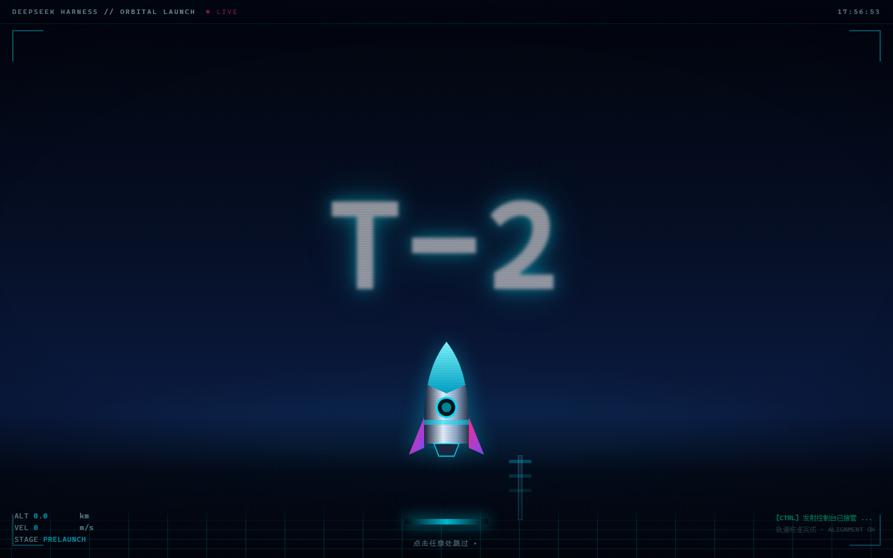
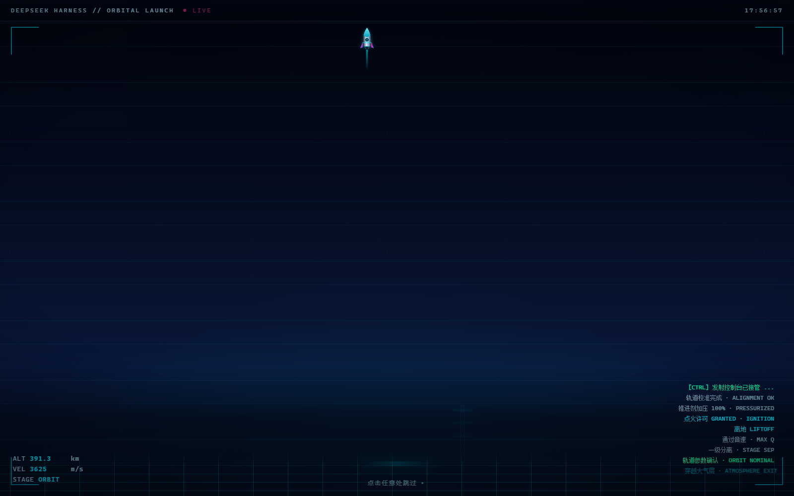
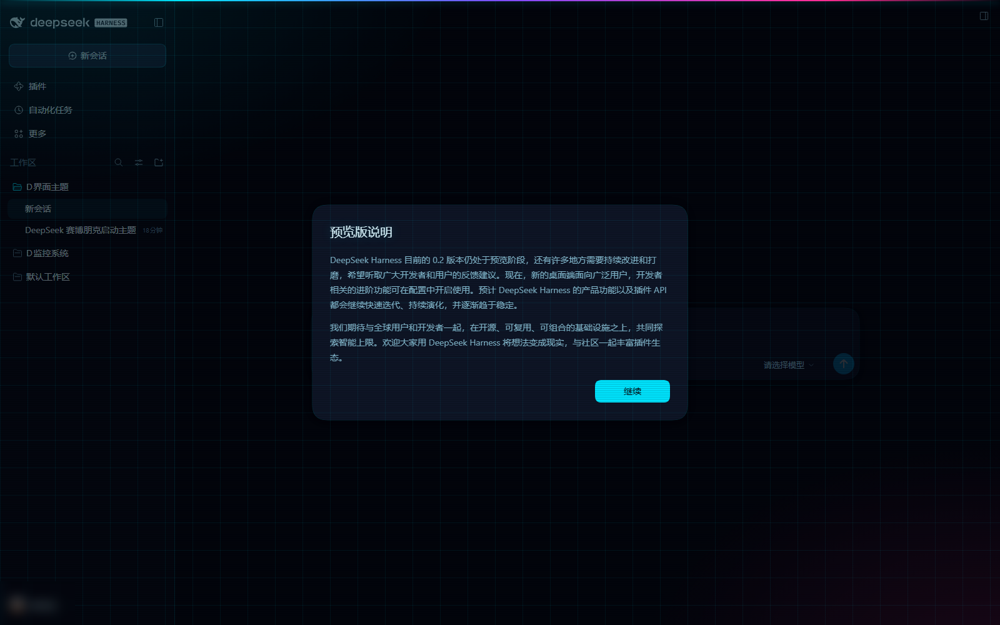

# DeepSeek Harness 赛博朋克主题 + 火箭发射转场

两件事，都装在 profile 用户目录里，**升级/重装 Harness 不会丢，开机启动直接生效**：

1. **赛博朋克主题** —— 整套 Web GUI 的霓虹配色、网格画布、辉光与扫描线。
2. **火箭发射 CG 转场** —— 启动界面完成后、进入应用界面前，播放一段
   发射台 → 点火 → 升空 → 穿越大气层 → 进入宇宙 → 交接到应用的动画。





> 仓库：<https://github.com/lindai335/deepseek-cyberpunk-theme>（公开发布）

---

## 0. 安装（给别人用）

```powershell
git clone https://github.com/lindai335/deepseek-cyberpunk-theme.git
cd deepseek-cyberpunk-theme
powershell -ExecutionPolicy Bypass -File tools\install-theme.ps1
```

脚本会把 `bundle/` 下的两个插件复制进当前 Harness profile 的 `bundles\` 目录，
并幂等地在 `cordis.patch.yml` 里写入两行 `insert`。之后**每次启动 Harness 都会**
先放赛博朋克主题，再在启动界面结束后播放火箭发射转场。

* 指定别的 profile：`powershell -File tools\install-theme.ps1 -ProfileDir C:\Users\<你>\.dsh\profiles\web`
* 卸载：删掉补丁层里 `cyberpunk-theme` / `rocket-boot` 两个 `insert` 块即可。

> Windows PowerShell 5.1 读取 `.ps1` 需要 UTF-8 BOM（本仓库内脚本已带 BOM）。

---

## 1. 已安装状态（本机）

| | 位置 |
| --- | --- |
| 已安装的插件 | `C:\Users\Administrator\.dsh\profiles\desktop\bundles\{cyberpunk-theme,rocket-boot}\` |
| profile 补丁层（加载入口） | `C:\Users\Administrator\.dsh\profiles\desktop\cordis.patch.yml` |
| 可编辑源 | `C:\D界面主题\bundle\{cyberpunk-theme,rocket-boot}\` |
| 同步脚本 | `C:\D界面主题\tools\install-theme.ps1` |

补丁层里两行 `insert` 就是开机时自动生效的入口：

```yaml
- insert:
    - id: cyberpunk-theme
      name: "C:/Users/Administrator/.dsh/profiles/desktop/bundles/cyberpunk-theme/index.js"
- insert:
    - id: rocket-boot
      name: "C:/Users/Administrator/.dsh/profiles/desktop/bundles/rocket-boot/index.js"
```

> 为什么装在 profile 而不是改 `app.asar`：profile 目录属于用户数据，不在安装包内，
> 升级 Harness 不会被覆盖；改安装包则会被升级覆盖，还可能撞上 Electron 的 asar 完整性校验。

## 2. 火箭发射转场（`bundle/rocket-boot`）

### 播放流程（约 7 秒）

| 时间 | 阶段 | 画面 |
| --- | --- | --- |
| 0.0s | `pad` | 发射台、透视网格、发射塔、火箭、倒计时 T-3→T-2→T-1、HUD 遥测（ALT/VEL/STAGE）、任务日志 |
| 0.84s | `ignite` | 点火闪光、镜头抖动、喷口火焰、地面烟雾、速度线 |
| 1.42s | `ascent` | 火箭加速升空（HUD 同步：MAX Q → 一级分离 → 轨道参数确认） |
| 4.0s | `orbit` | 冲出大气层：星空、星云、行星弧线与大气辉光、城市灯火，火箭化作远处光点 |
| 6.0s | `handover` | 「进入界面 / TRANSIT COMPLETE」标题 + 闪光 |
| 6.75s | 交接 | 覆盖层淡出，露出应用界面 |

* **随时可跳过**：点击任意处或按任意键，立刻进入应用。
* **永不挡路**：CSS 自带 9 秒自动淡出兜底，脚本另有 14 秒硬超时；
  即使脚本异常，覆盖层也会自行消失，应用不会被卡住。
* 叠加在应用之上（`z-index` 最高），应用在动画期间已经在后台完成挂载，
  动画一结束立即可用。

### 实现方式

和主题一样走 `webserver/index-inject`：Host 插件把 `rocket-boot.css` 注入 `<head>`、
把 `rocket-boot.client.js` 注入 `<body>`，脚本在页面解析阶段就建好覆盖层；
CSS 用一条 6 秒的关键帧时间线驱动火箭轨迹，JS 只负责切 `data-phase` 和写遥测数字。

### 改动画

编辑 `C:\D界面主题\bundle\rocket-boot\{rocket-boot.css,rocket-boot.client.js}` →
跑一次 `tools\install-theme.ps1` → 刷新页面即可（**不需要重启**，插件按 mtime 重新读取资源）。

本地预览（不启动 Harness）：

```powershell
$edge = "C:\Program Files (x86)\Microsoft\Edge\Application\msedge.exe"
& $edge --headless=old --disable-gpu --no-sandbox --window-size=1600,1000 `
        --screenshot="C:\D界面主题\preview\rocket-shot.png" `
        ([System.Uri]"C:\D界面主题\preview\rocket-demo.html").AbsoluteUri
```

## 3. 赛博朋克主题（`bundle/cyberpunk-theme`）

### 视觉三层

1. **调色板层（主力）**
   覆盖设计系统语义令牌 `--dsw-alias-*` / `--dsw-specific-*`：
   底色 `#04060d`、面板 `#0a0f1d`、霓虹青 `#00e5ff`、热洋红 `#ff2d95`、
   信号绿 `#00ffa3`、琥珀 `#ffc400`、危险红 `#ff2d6f`。
   面板、边框、文字、按钮、代码块、侧边栏、菜单、滚动条都由这些令牌派生。

   > 覆盖值带 `!important`：主题呈现器（`dsh-client-ui-layout`）会把当前快照
   > 以**行内自定义属性**写到 `body` 上，行内声明优先级高于普通样式表规则。

2. **画布层**：径向辉光（左上青、右下洋红）、全屏网格、扫描线薄膜、顶部霓虹光带。

3. **点缀层**：选区洋红、焦点环霓虹青、代码与标题辉光。

浅色 / 深色两套应用配色都会被替换（令牌同名、写在 body 上），界面始终是赛博朋克观感。

## 4. 一个真实的坑（已修）

Web 服务器渲染 index.html 时，把 `placement: 'body'` 的注入行拼接到**第一个** `<body>` 匹配之后。
而主题 CSS 的注释里原本写了 `<body>` 字样 —— 这个字样出现在 `<style>` 文本内部，
于是**所有 body 行都被塞进了样式表文本里**：主题自带的启动脚本和转场脚本都没执行。

表现是：主题配色生效了，但应用一直跑在浅色配色里（启动脚本负责设置
`data-ds-dark-theme`，没跑成就没设）。

修复与防护：

* 去掉 CSS 注释里的 `<body>` 字样；
* 两个插件在注入前都会检查资源文本里是否出现 `<body` / `<head`，
  命中就写一条警告日志，避免以后再踩同一个坑；
* 这条修复同时让**主题的启动脚本恢复工作**：现在应用以深色配色启动，
  首屏底色也是赛博朋克的 `#04060d`。

## 5. 验证记录

* **生命周期（真实应用页面，DevTools 协议实测）**
  `t=0.8s overlay=pad` → `2.0s ascent` → `3.5s ascent + darkAttr=true` →
  `5.5s orbit` → `8.0s overlay 已移除`；
  全程 `brand=#00e5ff`、`bg=rgb(4,6,13)`，应用 DOM 始终已挂载。
* **注入链路**：服务端返回的 index.html 中，`<style>` 落在 `<head>` 内且在应用样式表之前；
  `<script>` 落在真正的 `<body>` 标签之后（修复后）。
* **实时生效**：运行中改 `cyberpunk.css` 的主色 → 重新请求页面立刻返回新颜色，
  无需重启；改回同样即时生效。
* **逐帧目视**：发射台、点火、升空、进入宇宙四个阶段都抓了帧（见 `preview\`）。

## 6. 卸载 / 回退

* 只想去掉火箭动画：删掉补丁层里 `id: rocket-boot` 那三行（保留 `cyberpunk-theme`），
  刷新页面即可。
* 连主题一起还原：把两个 `insert` 块都删掉；`bundles\` 下的目录可一并删除。
* 想换回原来的高达开机动画：profile 里 `bundles\gundam-boot\` 目录还在，
  往补丁层加回 `- id: gundam-boot` 的 insert 行即可（该行已在本轮移除，
  因为它和火箭动画占用同一个转场位置）。

## 7. 目录结构

仓库里发布的内容：

```
deepseek-cyberpunk-theme\
├─ bundle\
│  ├─ cyberpunk-theme\        ← 主题（cyberpunk.css / index.js / package.json / locale / icon）
│  └─ rocket-boot\            ← 火箭转场（rocket-boot.css / rocket-boot.client.js / index.js / …）
├─ preview\
│  ├─ rocket-demo.html        ← 动画本地预览页（自包含，可直接双击打开）
│  ├─ rocket-pad.png / rocket-ascent.png / rocket-orbit.png
│  ├─ cyberpunk.png           ← 主题配色预览
│  └─ real-app.png            ← 真机界面（账号信息已打码）
├─ tools\
│  ├─ install-theme.ps1       ← 同步脚本（源码 → profile，幂等）
│  ├─ verify-theme.js         ← 安装链路校验
│  ├─ publish-github.mjs      ← 用 PAT 通过 Git Data API 发布（单 commit）
│  ├─ test-github.ps1         ← GitHub 连通性自检
│  ├─ cdp-*.js                ← DevTools 协议：读计算样式 / 抓帧 / 抓图 / 生命周期探针
│  └─ asar-*.js / extract-*.js← 解包与抽样式表的小工具
├─ .gitignore
└─ README.md
```

本地另外保留、**不进仓库**的部分：

| 路径 | 用途 |
| --- | --- |
| `extract\dist\` | 从安装包抽出的真实前端 CSS/HTML |
| `preview\palette.css` | 从应用抽出的真实主题令牌表（由 `tools/extract-palette-css.js` 生成） |
| `preview\demo.html` | 主题预览页（依赖上面两个本地文件） |
| `tools\yaml\` | 校验脚本用到的 YAML 解析库 |

也就是说：仓库自带的 `preview/rocket-demo.html` 可以直接打开看动画；
主题的完整预览页需要先在本地跑一次 `tools/extract-palette-css.js` 生成 `palette.css`。

## 8. 说明与边界

* 主题与动画都只作用于 **Web GUI**（桌面端内嵌窗口同源，因此同样生效）。
  Electron 原生欢迎页（`app.asar` 里的 `lib/welcome/*`，首启引导用）是另一套静态资源，
  没有改；需要的话可以再做一版。
* 动画每次加载 GUI 页面都会播放；刷新页面也会重播。嫌长可以把
  `rocket-boot.client.js` 里的 `later(dismiss, 6750)` 调小，或直接删掉整个
  `rocket-boot` 的 insert 行。
* 插件不提供设置项、不注入任何业务逻辑：主题只贡献一段 CSS，
  转场只贡献一段 CSS + 一段自包含脚本，卸载后不留副作用。
* 面向国内网络环境的两点实测提醒：
  * 到 GitHub 的线路会间歇性抖动，必要时用 `curl --resolve github.com:443:<可用边缘IP>` 固定节点；
  * Windows PowerShell 5.1 的 `Invoke-WebRequest` 访问 GitHub 会挂死，用 `curl.exe` 或 Node。
